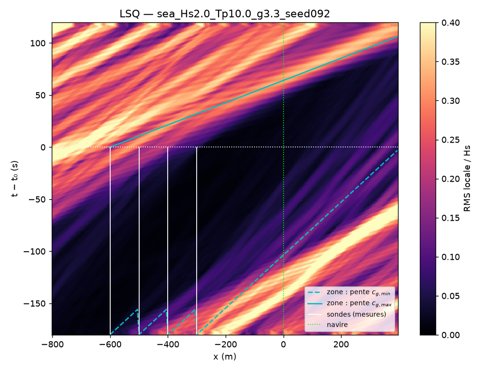
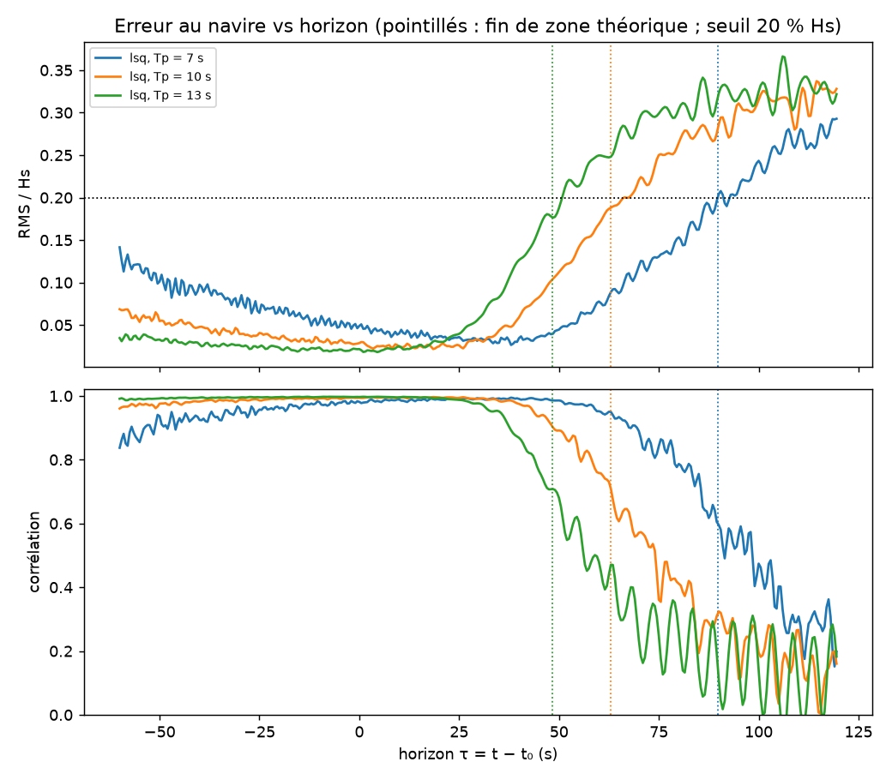
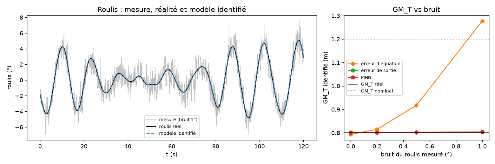
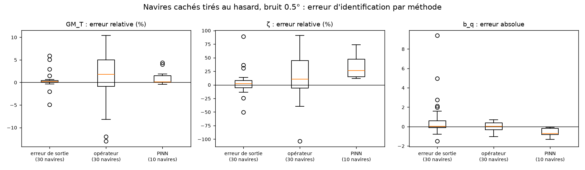

# Jumeau numérique : navire sur mer JONSWAP

Simulation temps réel d'un navire à 6 degrés de liberté (équation de Cummins) sur une mer
irrégulière directionnelle (spectre JONSWAP), avec rendu 3D interactif (PyVista / Qt).
L'état de mer, la navigation et le navire lui-même se modifient en direct, pendant la simulation.
Un mode **Prévision** prédit 10 à 60 s à l'avance la houle qui arrive sur le navire et ses mouvements,
à partir de sondes placées en amont.

---

## Sommaire

1. [Logique physique](#1-logique-physique)
2. [Réalisation de la simulation](#2-réalisation-de-la-simulation)
3. [Utilisation](#3-utilisation)
4. [Références](#4-références)
5. [Prévision déterministe de la houle](#5-prévision-déterministe-de-la-houle)
6. [Identification du navire : recaler le jumeau sur ses mesures](#6-identification-du-navire--recaler-le-jumeau-sur-ses-mesures)
7. [Comparaison des performances](#7-comparaison-des-performances)

---

## 1. Logique physique

Le jumeau numérique couple deux modèles : une **mer** qui produit à chaque instant la surface libre
$\eta(x,y,t)$, et un **navire** dont le mouvement est piloté par la houle vue sous sa flottaison.

### 1.1 Modèle de mer — houle irrégulière JONSWAP ([jonswap.py](jonswap.py))

**Théorie linéaire (Airy).** Une mer réelle est vue comme la superposition d'un grand nombre de
vagues sinusoïdales indépendantes, de fréquences $\omega$ et de directions $\theta$ différentes, à phases
aléatoires $\varphi$ :

$$
\eta(x,y,t) = \sum_{i,j} A_{ij}\cos\!\big(k_{x,ij}\,x + k_{y,ij}\,y - \omega_i t + \varphi_{ij}\big),
\qquad k_x = k\cos\theta,\; k_y = k\sin\theta
$$

**Relation de dispersion (eaux profondes).** Fréquence et nombre d'onde sont liés par
$k = \omega^2 / g$ : les vagues longues vont plus vite que les courtes. (Une version en profondeur finie,
$\omega^2 = g k \tanh(kh)$, existe dans `dispersion_relation` mais n'est pas utilisée.)

**Spectre JONSWAP.** La répartition de l'énergie entre fréquences suit le spectre JONSWAP
(Hasselmann 1973) : un spectre de Pierson-Moskowitz (mer pleinement développée) renforcé autour du pic
par un facteur $\gamma^r$ :

$$
S(\omega) = \alpha\,\frac{g^2}{\omega^5}\exp\!\left[-\frac54\left(\frac{\omega_p}{\omega}\right)^4\right]\gamma^{\,r},
\qquad r = \exp\!\left[-\frac{(\omega-\omega_p)^2}{2\sigma^2\omega_p^2}\right]
$$

avec $\omega_p = 2\pi/T_p$, $\sigma = 0.07$ si $\omega \le \omega_p$, $0.09$ sinon. $\gamma = 3.3$ est la
valeur standard (mer du Nord) ; $\gamma = 1$ redonne Pierson-Moskowitz.

**Étalement directionnel.** L'énergie est répartie autour de la direction moyenne $\theta_m$ par
$D(\theta) \propto \cos^{2s}(\theta - \theta_m)$, normalisée à $\int D\,d\theta = 1$. Plus $s$ est grand,
plus la houle est unidirectionnelle (houle longue) ; $s$ petit donne une mer croisée (mer du vent).

**Amplitudes.** Chaque composante reçoit l'énergie de sa case $(d\omega, d\theta)$ :
$A = \sqrt{2\,S(\omega)\,D(\theta)\,d\omega\,d\theta}$. Les amplitudes sont ensuite **renormalisées**
pour que la hauteur significative simulée soit exactement celle demandée, $H_s = 4\sigma_\eta$
(la formule analytique de $\alpha$ ignore le gain d'énergie du pic JONSWAP, ≈ ×1.5 pour $\gamma = 3.3$).

**Crêtes « choppy » (Tessendorf 2001).** Pour l'affichage uniquement, les points de la surface sont
déplacés horizontalement vers les crêtes, ce qui les rend plus pointues et les creux plus larges,
comme les vraies vagues de tempête. Là où ce déplacement comprime la surface (jacobien $J$ petit),
de l'écume est dessinée. **La physique du navire utilise l'élévation $\eta$ non déformée.**

### 1.2 Modèle de navire — équation de Cummins ([boat.py](boat.py))

**Les 6 degrés de liberté (DDL).**

| DDL | Nom | Translation / rotation |
|-----|-----|------------------------|
| 1 | Cavalement (*surge*) | avance selon x navire |
| 2 | Embardée (*sway*) | dérive latérale |
| 3 | Pilonnement (*heave*) | montée / descente |
| 4 | Roulis (*roll*) | rotation autour de l'axe longitudinal |
| 5 | Tangage (*pitch*) | rotation autour de l'axe transversal |
| 6 | Lacet (*yaw*) | cap |

**Équation du mouvement.** Le navire suit l'équation de Cummins (1962) linéarisée (Ogilvie 1964), où
les coefficients sont évalués à la fréquence de rencontre $\omega_e$ :

$$
\big[M + A(\omega_e)\big]\,\ddot{\boldsymbol\eta} + B(\omega_e)\,\dot{\boldsymbol\eta}
+ C_{cor}\,\dot{\boldsymbol\eta} + C\,\boldsymbol\eta
= F_{exc} + F_{prop}
$$

| Terme | Signification | Modélisation |
|-------|---------------|--------------|
| $M$ | masse et inerties du navire | $m = \rho\,C_b L B T$ ; $I_{xx} = m(k_{xx}B)^2$, $I_{yy} = I_{zz} = m(k_{yy}L)^2$ |
| $A(\omega_e)$ | **masse ajoutée** : eau mise en mouvement avec la coque | fractions de $\rho LBT$ (translations) et de $\rho LB^3/12$, $\rho L^3B/12$ (rotations), ±15 % autour de $\omega_p$ ; couplages sway-roll et heave-pitch |
| $B(\omega_e)$ | **amortissement radiatif** : énergie évacuée par les vagues que le navire crée | $B_{ii} = B_{0,ii}\sqrt{\omega_e/\omega_n}$, avec $B_0$ choisi pour un taux d'amortissement critique $\zeta$ typique (5 à 10 % selon le DDL) |
| $C$ | **raideur hydrostatique** (poussée d'Archimède) | $C_{33} = \rho g A_{wp}$, $C_{44} = \rho g \nabla\,GM_T$, $C_{55} = \rho g \nabla\,GM_L$, couplage $C_{35} = -\rho g A_{wp} x_f$ |
| $C_{cor}$ | Coriolis linéarisé | couplage embardée / lacet proportionnel à la vitesse d'avance |
| $F_{exc}$ | forces de houle | voir ci-dessous |
| $F_{prop}$ | propulsion | poussée $B_{11}\,U_{cible}$ : la vitesse converge vers la consigne |

Les coefficients hydrodynamiques sont une version **simplifiée** des formules de la théorie des tranches
(Salvesen, Tuck & Faltinsen 1970) : ordres de grandeur réalistes, mais pas de calcul de potentiel.

**Fréquence de rencontre.** Un navire qui avance voit passer les vagues à une fréquence différente
de leur fréquence propre (effet Doppler) :

$$
\omega_e = \omega_p - \frac{\omega_p^2}{g}\,V\cos\mu
$$

où $\mu$ est l'angle entre le cap et la direction de propagation de la houle
($0°$ = houle de l'arrière, $90°$ = de travers, $180°$ = de face). $\omega_e$ est bornée à
$[\omega/5,\,2\omega]$ pour éviter la singularité de la houle suiveuse.

**Forces de houle (Froude-Krylov hydrostatique).** À chaque pas, on ajuste par moindres carrés un plan
$\zeta \approx \bar\zeta + s_x x_b + s_y y_b$ sur la surface de mer échantillonnée en 11 × 5 points
sous la flottaison. Ce plan donne la position « idéale » qu'aurait un navire épousant parfaitement la
houle : pilonnement $\bar\zeta$, roulis $\arctan s_y$, tangage $-\arctan s_x$. La raideur tire le navire
vers cette position : $F_{exc} = C\,\boldsymbol\eta_{houle}$. La masse ajoutée et l'amortissement
introduisent le retard de phase et filtrent les vagues courtes ; le moyennage sur toute la flottaison
filtre naturellement les vagues plus courtes que le navire.

**Résonance.** Chaque DDL avec rappel hydrostatique a une période propre
$T_n = 2\pi\sqrt{(M + A)/C}$. Quand la période de rencontre $T_e = 2\pi/\omega_e$ s'en approche,
la réponse est amplifiée (roulis synchrone d'un cargo en houle de travers, par exemple).

### 1.3 Hypothèses et limites

- Théorie linéaire : petites amplitudes de mouvement, pas de déferlement, pas d'interaction vague-vague.
- Eaux profondes uniquement ; pas de diffraction ni de radiation calculées (coefficients empiriques).
- La houle n'excite que pilonnement, roulis et tangage ; cavalement, embardée et lacet ne sont pas
  excités (pas de dérive, pas de force de second ordre).
- Pas de stabilité à grands angles (courbe GZ) : le navire ne peut pas chavirer de façon réaliste.
- Rotation repère navire → repère terrestre appliquée seulement à la position horizontale (petits angles
  pour le reste).
- Domaine de mer périodique de 600 m × 600 m : le navire réapparaît de l'autre côté.

---

## 2. Réalisation de la simulation

### 2.1 Architecture

| Fichier | Rôle |
|---------|------|
| [main.py](main.py) | Point d'entrée : fenêtre Qt, boucle temps réel, liaison panneau ↔ simulation |
| [jonswap.py](jonswap.py) | Mer : spectre, génération de la surface, transitions d'état de mer, couleurs et normales |
| [boat.py](boat.py) | Caractéristiques du navire (`BoatParams`), modèle hydrodynamique (`HydroModel`), maillage de coque (`Boat`) |
| [boat_presets.py](boat_presets.py) | Les 6 navires prédéfinis |
| [simulation.py](simulation.py) | Couplage mer → navire et pas de temps, indépendant de l'affichage |
| [scene.py](scene.py) | Scène 3D PyVista : mer, coque, ligne de flottaison, repères, texte d'infos |
| [ui_panel.py](ui_panel.py) | Panneau de contrôle Qt (émet des signaux, ne connaît pas la physique) |
| [forecast_panel.py](forecast_panel.py) | Dock Qt des courbes de prévision (mode Prévision) |
| [waveforecast/](waveforecast/) | Prévision de la houle et des mouvements (voir [§5](#5-prévision-déterministe-de-la-houle)) |
| [shipid/](shipid/) | Identification du roulis du navire : erreur de sortie, PINN, opérateur neuronal, calibration du jumeau (voir [§6](#6-identification-du-navire--recaler-le-jumeau-sur-ses-mesures)) |
| [scripts/](scripts/), [tests/](tests/) | Génération des jeux de données, évaluation, tests (`pytest`) |

À chaque image (`Simulation.step`) :

```
1. Transition éventuelle de l'état de mer      SeaState.advance
2. Surface de mer η(x,y,t) + déplacements       SeaState.generate_fields
3. Houle sous la flottaison (ζ̄, s_x, s_y)        HydroModel.waterplane_wave
4. Intégration de Cummins (RK4, n sous-pas)     HydroModel.step_state
5. Mise à jour de l'affichage                   Scene.update
```

### 2.2 Discrétisation

| Grandeur | Valeur | Justification |
|----------|--------|---------------|
| Domaine | 600 m × 600 m | ≥ 2 longueurs d'onde au pic ($\lambda_p \approx 306$ m à $T_p = 14$ s) |
| Maille | 4 m (151 × 151 points) | résout les vagues jusqu'à $4\omega_p$ |
| Fréquences | 30, de $0.5\,\omega_p$ à $4\,\omega_p$ | contient l'essentiel de l'énergie |
| Directions | 17, sur ±90° autour de $\theta_m$ | |
| Coupure | composantes de longueur < 3 mailles mises à zéro | évite le repliement de spectre aux petits $T_p$ |
| Pas de temps | $dt = 0.05$ s | |
| Intégrateur | Runge-Kutta 4 | |

Vérification (`python jonswap.py`) : la hauteur significative mesurée sur la surface simulée
correspond à la consigne.

```
Hs=  1.0 m  Tp= 6.0 s  →  Hs simulé ≈  1.01 m
Hs=  6.0 m  Tp= 8.0 s  →  Hs simulé ≈  6.17 m
Hs= 16.0 m  Tp=14.0 s  →  Hs simulé ≈ 16.05 m
Hs=  3.0 m  Tp= 4.0 s  →  Hs simulé ≈  2.98 m
Continuité au point de référence : +1.485 m → +1.485 m
```

### 2.3 Techniques employées

- **Surface en un produit matriciel.** Évaluer 510 cosinus en 22 801 points à chaque image serait trop
  lent. La somme est réécrite $\eta = \mathrm{Re}\big[E_y\,\mathrm{diag}(c(t))\,E_x^\top\big]$, avec
  $E_x = e^{i k_x x}$ et $E_y = e^{i k_y y}$ précalculés : seul le vecteur $c(t) = A\,e^{i(\varphi - \omega t)}$
  change. Calcul en `complex64` (≈ 2× plus rapide, erreur ~10⁻⁶ m). Élévation et déplacements choppy
  sont obtenus dans le même produit.
- **Mer non périodique.** Les fréquences sont tirées au hasard dans leur bande (*jitter*) : sans cela,
  la mer se répéterait toutes les ~66 s. Phases et jitter sont tirés une fois (graine 42) : la mer
  garde sa « personnalité » quand on change ses paramètres.
- **Transitions douces.** Un changement de paramètre de mer fixe une *cible* ; les paramètres courants
  s'en rapprochent exponentiellement (constante de temps τ = 3 s). Quand $T_p$ ou la direction changent,
  les phases sont corrigées pour que la surface reste **continue sous le navire** (pas de saut brutal).
- **Temps réel.** Le temps simulé suit l'horloge : si une image prend plus de $dt$, la physique fait
  jusqu'à 4 sous-pas pour rattraper ; au-delà, le retard est abandonné plutôt qu'accumulé.
- **Rendu GPU.** Les maillages VTK sont créés une fois puis modifiés en place. Couleur de la mer selon
  l'élévation (échelle fixe liée à $H_s$, sans scintillement), écume aux crêtes, normales calculées pour
  les reflets. La coque change de couleur là où elle est réellement immergée, et la ligne de flottaison
  réelle (intersection coque / mer) est tracée en noir.
- **Exagération verticale ×2** à l'affichage uniquement (une houle de 300 m de long paraît plate à
  l'échelle réelle). Les graduations restent en mètres réels.

---

## 3. Utilisation

### 3.1 Installation et lancement

Prérequis : Python 3.10 ou plus récent (testé avec 3.13), carte graphique compatible OpenGL.

```powershell
python -m venv venv
venv\Scripts\activate            # Linux / macOS : source venv/bin/activate
pip install -r requirements.txt
python main.py
```

Auto-test du modèle de mer, sans interface : `python jonswap.py`. Tests : `python -m pytest tests`.

### 3.2 L'interface

- **Vue 3D (centre).** Souris : clic gauche = rotation, molette = zoom, clic molette ou Maj + clic =
  déplacement.
- **Texte d'infos (haut gauche)** : navire et déplacement ; temps simulé et images/s ; état de mer
  courant (« transition en cours » pendant un changement) ; crête max, creux min et $H_s$ mesuré ;
  pilonnement et houle moyenne sous la flottaison ; roulis et tangage ; $\omega_e$ et $T_e$ ;
  vitesse, cap, angle $\mu$ et incidence (houle de l'arrière / de hanche / de travers / de joue / de face).
- **Mât de marée** rayé rouge et blanc, planté au niveau de mer calme, gradué en mètres.
- **Lignes de niveau** sur la mer ; le niveau 0 (mer calme) est en jaune.
- **Légende** des couleurs de la mer (élévation en m).
- **Panneau « Contrôles » (droite)**, détachable, en cinq groupes : mer, navigation et navire (décrits
  ci-dessous), prévision de houle ([§5.4](#54-le-mode-prévision-dans-le-jumeau)) et calibration
  ([§6.5](#65-calibration-dans-le-jumeau)).
- **Dock « Prévision » (bas)**, visible en mode Prévision : courbes de mouvement prévues.

### 3.3 Mer — effet immédiat, transition douce

| Paramètre | Plage | Défaut | Effet |
|-----------|-------|--------|-------|
| Hauteur $H_s$ | 0.5 – 18 m | 16 m | hauteur significative (moyenne du tiers des plus hautes vagues) |
| Période $T_p$ | 4 – 18 s | 14 s | période de pic ; fixe la longueur d'onde $\lambda_p = gT_p^2/2\pi$ |
| Pic $\gamma$ | 1 – 7 | 3.3 | concentration de l'énergie autour du pic (1 = Pierson-Moskowitz) |
| Direction | 0 – 360° | 0° | sens de **propagation** de la houle (0° = vers +X) |
| Étroitesse $s$ | 1 – 10 | 1 | étalement directionnel : grand = houle unidirectionnelle |
| Crêtes choppy | 0 – 1.2 | 0.8 | crêtes pointues à l'affichage (n'affecte pas la physique) |

Préréglages (menu « État de mer ») :

| Préréglage | $H_s$ | $T_p$ |
|------------|-------|-------|
| Calme | 1 m | 6 s |
| Agitée | 6 m | 8 s |
| Tempête | 12 m | 11 s |
| Ouragan | 16 m | 14 s |

### 3.4 Navigation — effet immédiat

| Contrôle | Effet |
|----------|-------|
| Vitesse (0 – 15 m/s) | vitesse de consigne ; le navire y converge progressivement |
| Cap (0 – 360°) | cap imposé (0° = vers +X) ; change l'incidence de la houle |
| Caméra suit le bateau | la caméra accompagne le navire |
| Pause / Reprendre | gèle le temps (les changements de mer s'appliquent alors d'un coup) |
| Recentrer vue | caméra basse centrée sur le navire |
| Réinitialiser | navire replacé au centre, au repos |

### 3.5 Navire — appliqué à chaud

Choisir un **Type**, ajuster éventuellement ses caractéristiques, puis cliquer **Appliquer**
(« Appliquer * » signale des modifications non appliquées). Le nouveau navire remplace l'ancien en
gardant position, cap et vitesse. Un aperçu affiche son déplacement et ses périodes propres, ou les
erreurs de validation (le bouton est alors désactivé). **Rétablir le préréglage** annule les modifications.

| Caractéristique | Signification | Contrainte de validation |
|-----------------|---------------|--------------------------|
| Longueur $L$ | longueur à la flottaison | 5 – 400 m |
| Largeur $B$ | largeur | $0 < B < L$ |
| Tirant d'eau $T$ | enfoncement de la quille | $0 < T < B$ |
| Coef. de bloc $C_b$ | finesse de carène : $\nabla = C_b LBT$ | 0.35 – 0.90 |
| Coef. flottaison $C_{wp}$ | surface de flottaison : $A_{wp} = C_{wp} LB$ | $C_b \le C_{wp} \le 1$ |
| GM transversal | hauteur métacentrique : stabilité en roulis | > 0 |
| GM longitudinal | stabilité en tangage | > 0 |
| Giration roulis / B | rayon de giration $k_{xx}$ (inertie de roulis) | 0.2 – 0.5 |
| Giration tangage / L | rayon de giration $k_{yy}$ (inertie de tangage et lacet) | 0.15 – 0.35 |
| Franc-bord / T | hauteur de coque hors de l'eau, relative au tirant d'eau | > 0 |
| Amort. roulis ζ | amortissement linéaire de roulis (fraction du critique) | 0 < ζ ≤ 0.5 |
| Amort. roulis quadr. | amortissement quadratique $b_q$ (quilles de roulis, viscosité) | ≥ 0 |
| Couleur coque | couleur des œuvres mortes | couleur valide |

Repères : un **GM_T faible** donne un roulis lent et ample (période de roulis longue), un GM_T élevé un
roulis raide et court ; $C_b$ change aussi la forme affichée de la coque (en V pour une coque fine,
fond plat et murailles droites pour un cargo).

**Navires prédéfinis** (périodes propres calculées à $T_p = 14$ s) :

| Type | L × B × T (m) | $C_b$ | GM_T (m) | Vitesse | Déplacement | $T_n$ pilon. / roulis / tangage |
|------|---------------|-------|----------|---------|-------------|----------------------------------|
| Cargo | 100 × 20 × 8 | 0.61 | 1.2 | 2.5 m/s | 10 000 t | 5.5 / 13.2 / 5.1 s |
| Porte-conteneurs | 250 × 32 × 12 | 0.65 | 1.5 | 8 m/s | 64 000 t | 6.9 / 18.7 / 6.1 s |
| Frégate | 125 × 15 × 4.5 | 0.50 | 1.0 | 10 m/s | 4 300 t | 4.1 / 11.2 / 4.3 s |
| Chalutier | 35 × 9 × 4 | 0.55 | 0.8 | 4 m/s | 710 t | 3.8 / 7.5 / 3.9 s |
| Remorqueur | 30 × 10 × 4.5 | 0.60 | 1.5 | 3 m/s | 830 t | 4.1 / 6.0 / 4.0 s |
| Yacht à moteur | 25 × 6 × 1.8 | 0.45 | 1.0 | 6 m/s | 125 t | 2.5 / 4.9 / 3.2 s |

Ajouter un navire : une ligne `BoatParams(...)` dans `PRESETS` ([boat_presets.py](boat_presets.py)) ;
il apparaît automatiquement dans le menu.

### 3.6 Scénarios d'exemple

- **Résonance en roulis** : Cargo, cap 90° (houle de travers), $T_p \approx 13$ s, $H_s$ = 6 m. La période de
  rencontre coïncide avec la période de roulis (13.2 s) : le roulis devient important.
  Passer le cap à 0° ou 180° : le roulis retombe.
- **Effet de la vitesse** : Frégate, houle de face, vitesse 0 puis 15 m/s : $T_e$ raccourcit nettement
  (lisible dans le texte d'infos) et le tangage change.
- **Taille du navire** : même mer « Tempête », Yacht puis Porte-conteneurs : le petit navire épouse
  chaque vague, le grand filtre les vagues plus courtes que lui.
- **Prévision** : mer « Agitée », Cargo, cap 60°, cocher *Mode prévision*. Les courbes prévues suivent la
  vérité jusqu'à la fin de la zone de prédictibilité (≈ 60 s à $T_p$ = 8 s, 34 s à $T_p$ = 14 s : les
  vagues longues, plus rapides, réduisent l'horizon), puis s'en écartent.

### 3.7 Réglages avancés (dans le code)

| Constante | Fichier | Rôle |
|-----------|---------|------|
| `DT`, `MAX_SUBSTEPS` | [main.py](main.py) | pas de temps physique, sous-pas max. de rattrapage |
| `Lx`, `Ly`, `dx`, `dy` | [jonswap.py](jonswap.py) | taille du domaine et maille |
| `N_freq`, `N_dir` | [jonswap.py](jonswap.py) | nombre de composantes spectrales (précision ↔ vitesse) |
| `DEFAULTS`, `SEA_PRESETS`, `TAU` | [jonswap.py](jonswap.py) | mer initiale, préréglages, durée des transitions |
| `Z_SCALE`, `SEA_OPACITY`, `HS_MAX` | [scene.py](scene.py) | exagération verticale, transparence de la mer, bornes des axes |
| `SEA_FIELDS`, `BOAT_FIELDS` | [ui_panel.py](ui_panel.py) | plages des curseurs et champs |
| `PERIOD`, `HORIZON`, `T_WIN`, `SHIP_X`, `PROBE_OFFSETS`, `CALM_*` | [waveforecast/forecast.py](waveforecast/forecast.py) | cadence et horizon de prévision, fenêtre de mesure, position des sondes, seuils de période calme |

---

## 4. Références

- Hasselmann K. et al. (1973). *Measurements of wind-wave growth and swell decay during the Joint North
  Sea Wave Project (JONSWAP)*.
- Cummins W. E. (1962). *The impulse response function and ship motions*.
- Ogilvie T. F. (1964). *Recent progress toward the understanding and prediction of ship motions*.
- Salvesen N., Tuck E. O., Faltinsen O. (1970). *Ship motions and sea loads*.
- Tessendorf J. (2001). *Simulating Ocean Water*.
- Fossen T. I. (2011). *Handbook of Marine Craft Hydrodynamics and Motion Control*.
- Raissi M., Perdikaris P., Karniadakis G. E. (2019). *Physics-informed neural networks: A deep learning
  framework for solving forward and inverse problems involving nonlinear partial differential equations*.
- Li Z., Kovachki N., Azizzadenesheli K. et al. (2021). *Fourier Neural Operator for Parametric Partial
  Differential Equations*. ICLR.
- Naaijen P., Trulsen K., Blondel-Couprie E. (2014). *Limits to the extent of the spatio-temporal domain for
  deterministic wave prediction*. International Shipbuilding Progress.

---

## 5. Prévision déterministe de la houle

Le mode **Prévision** prédit, 10 à 60 s à l'avance, la houle qui va atteindre le navire et les mouvements
qu'elle provoquera, à partir de quelques sondes placées en amont. C'est le besoin des opérations sensibles
au mouvement : appontage d'hélicoptère ou de drone, transfert de personnel vers une éolienne offshore.

### 5.1 Principe : la zone de prédictibilité

La houle est **dispersive** : chaque fréquence se propage à sa propre vitesse. L'information (l'énergie)
voyage à la **vitesse de groupe** $c_g = d\omega/dk = g/2\omega$ en eau profonde, deux fois moins vite que
les crêtes. Si des sondes mesurent pendant $[t_0 - T, t_0]$, un point situé à une distance $d$ en aval n'est
prévisible que pendant

$$
t \in \Big[\,t_0 - T + \frac{d}{c_{g,min}}\;,\;\; t_0 + \frac{d}{c_{g,max}}\,\Big]
$$

où $c_{g,min}$ et $c_{g,max}$ sont les vitesses de groupe des composantes les plus courtes et les plus longues
(bande contenant 90 % de l'énergie). Au-delà de $t_0 + d/c_{g,max}$, une partie de la houle qui arrive n'est
jamais passée devant les sondes : **aucune méthode ne peut la deviner**. Horizon maximal : $d / c_{g,max}$
(≈ 60 s pour des sondes à 560 m en amont, $T_p = 10$ s).

### 5.2 Méthode : reconstruction linéaire par moindres carrés

La mer mesurée est approchée par une somme d'ondes d'Airy à dispersion imposée,

$$
\hat\eta(x,t) = \sum_m a_m\cos(k_m x - \omega_m t) + b_m \sin(k_m x - \omega_m t), \qquad k_m = \omega_m^2/g,
$$

avec $\omega_m$ espacées de $2\pi/T$ (résolution de la fenêtre de mesure) sur la bande contenant 99 % de
l'énergie. Les coefficients sont obtenus par moindres carrés régularisés (Tikhonov) sur les mesures des
sondes, en quelques millisecondes. Chaque composante vérifie exactement la théorie potentielle linéarisée
(Laplace, conditions de surface, dispersion) : en houle linéaire, c'est la reconstruction physique exacte.

> Un PINN en potentiel $\varphi(x,z,t)$ a aussi été essayé : il ajuste les sondes mais ne propage pas
> l'information sur plusieurs longueurs d'onde sans un entraînement de l'ordre de l'heure sur GPU par fenêtre
> de mesure, et en houle linéaire il ne peut au mieux qu'égaler cette reconstruction. Il a été abandonné.

### 5.3 Résultats

Évaluation sur 18 mers de test (houle unidirectionnelle, $H_s$ 1-4 m, $T_p$ 7-13 s, $\gamma$ 1 et 3.3 ;
4 sondes de 600 à 300 m en amont, bruit 3 % de $H_s$, fenêtre de 180 s, une prévision toutes les 20 s) :

| $T_p$ | Horizon utile (erreur RMS > 20 % $H_s$) | Horizon théorique $d/c_{g,max}$ | Erreur dans la zone | Erreur au-delà |
|-------|------|------|------|------|
| 7 s  | 90 s   | 89.9 s | 7 % $H_s$ | 26 % $H_s$ |
| 10 s | 66.5 s | 62.9 s | 6 % $H_s$ | 29 % $H_s$ |
| 13 s | 51 s   | 48.4 s | 6 % $H_s$ | 31 % $H_s$ |

L'horizon utile mesuré coïncide avec l'horizon théorique à 3 s près. Sur la carte (x, t) de l'erreur,
la région bien prédite est exactement délimitée par les droites de pente $c_{g,min}$ et $c_{g,max}$ :





### 5.4 Le mode Prévision dans le jumeau

Régler la mer (une mer modérée, par ex. « Agitée »), choisir le navire et un cap oblique (ex. 60° : du roulis
apparaît), puis cocher **Mode prévision** dans le panneau :

- la mer devient une **houle unidirectionnelle figée** de mêmes $H_s$, $T_p$, $\gamma$ (256 composantes, vers +X) ;
  les curseurs de mer sont verrouillés ; décocher rend la mer précédente intacte ;
- le navire est placé **en station** en X = 500 m ; 4 **sondes** (bouées orange) mesurent la mer de
  300 à 450 m en amont, à 2 Hz, avec 3 % de bruit ;
- toutes les 5 s, la houle est reconstruite sur les 180 dernières secondes de mesures, puis deux
  **navires fantômes** (même modèle de Cummins) sont intégrés sur 60 s : l'un avec la houle prévue, l'autre
  avec la houle exacte (« vérité », connue puisque la mer est simulée) ;
- le **dock Prévision** affiche pilonnement, roulis et tangage : passé réel, prévision, vérité, et la
  **fin de la zone de prédictibilité** (au-delà, zone rouge : la prévision n'est plus fiable) ;
- **période calme** : OUI si le pilonnement et le roulis prévus restent sous 0.5 m et 2° pendant les 30
  prochaines secondes (limitées à la zone de prédictibilité) ;
- une **coque fantôme** translucide montre la position prévue à $t + \Delta$ (Δ réglable de 0 à 60 s).

Le calcul d'une prévision (≈ 0.4 s) tourne dans un thread : l'affichage reste fluide.
Limites : houle linéaire unidirectionnelle, eau profonde, navire en station ou lent (les points de
flottaison sont pris à leur position au moment de la prévision).

### 5.5 Reproduire

| Fichier | Rôle |
|---------|------|
| [waveforecast/physics.py](waveforecast/physics.py) | mer 1D vérité, vitesse de groupe, bande d'énergie, zone de prédictibilité |
| [waveforecast/sensors.py](waveforecast/sensors.py) | sondes virtuelles (position, échantillonnage, bruit) |
| [waveforecast/baseline_lsq.py](waveforecast/baseline_lsq.py) | reconstruction par moindres carrés |
| [waveforecast/evaluate.py](waveforecast/evaluate.py) | erreur vs horizon, carte (x, t), horizon utile |
| [waveforecast/forecast.py](waveforecast/forecast.py) | mode Prévision : mer figée, sondes, navires fantômes, période calme |
| [waveforecast/data.py](waveforecast/data.py) | jeux de données `.npz` (graine dans le nom, vérité et mesures séparées) |
| [forecast_panel.py](forecast_panel.py) | dock Qt des courbes de prévision |

```powershell
python scripts/make_dataset.py     # 54 mers, sondes, data/splits/index.csv (train / val / test par mer)
python scripts/run_eval.py         # métriques et figures dans results/
python -m pytest tests             # physique, reconstruction, mode Prévision
```

---

## 6. Identification du navire : recaler le jumeau sur ses mesures

Ce simulateur est un **jumeau générique** : les caractéristiques du navire sont saisies à la main. Pour devenir
le jumeau d'un navire **réel**, il doit se recaler sur ses mouvements mesurés.

### 6.1 Le problème : identifier ce qu'on ne connaît pas

Les grandeurs les plus incertaines du modèle sont aussi celles qui pèsent le plus sur la sécurité :

- **GM_T**, qui dépend du chargement, des carburants, de l'eau embarquée, et change au cours d'un voyage ;
- **l'amortissement de roulis**, non linéaire (quilles de roulis, viscosité) : linéaire $\zeta$ et
  quadratique $b_q$ (paramètres `zeta_roll` et `roll_quad` de `BoatParams`, 0.10 et 0 par défaut).

À poste fixe, le roulis du jumeau obéit à une équation à 1 DDL (le couplage avec l'embardée modifie
l'inertie de 0.002 %) :

$$
\ddot\varphi + 2\zeta\omega_n\dot\varphi + \omega_n^2\,(\varphi - \varphi_w) + b_q\,|\dot\varphi|\,\dot\varphi = 0,
\qquad \varphi_w = \arctan s_y,\quad \omega_n^2 = \frac{\rho g \nabla\, GM_T}{I_{xx} + A_{44}}
$$

où $\varphi_w$ est la pente transversale de la houle sous la flottaison (cf. §1.2). Les mesures (roulis et
houle) déterminent $\omega_n$, $\zeta$ et $b_q$ ; **$GM_T$ s'en déduit si l'inertie $I_{xx} + A_{44}$ est
connue** (plans du navire) — c'est l'hypothèse retenue.

### 6.2 Trois méthodes comparées ([shipid/identify.py](shipid/identify.py))

| Méthode | Principe | Coût |
|---------|----------|------|
| Erreur d'équation | dérivées $\dot\varphi$, $\ddot\varphi$ par Savitzky-Golay, puis régression linéaire sur l'équation | immédiat |
| Erreur de sortie | on simule l'équation et on ajuste $(\omega_n, \zeta, b_q, \varphi_0, \dot\varphi_0)$ pour reproduire $\varphi$ mesuré (`scipy.optimize.least_squares`) | < 1 s |
| PINN | réseau $\varphi_\theta(t)$ ajusté aux mesures sous contrainte du résidu de l'équation (dérivées par autograd), $\omega_n$, $\zeta$, $b_q$ entraînables, partant du modèle nominal | ≈ 100 s (CPU) |

$$
\mathcal{L} = \big\|\varphi_\theta - \varphi_{mes}\big\|^2
+ \lambda\,\big\|\ddot\varphi_\theta + 2\zeta\omega_n\dot\varphi_\theta + \omega_n^2(\varphi_\theta - \varphi_w)
+ b_q|\dot\varphi_\theta|\dot\varphi_\theta\big\|^2
$$

### 6.3 Résultats sur un navire « réel » simulé

Le jumeau simule un Cargo dont les caractéristiques sont cachées ($GM_T$ = 0.8 m au lieu de 1.2,
$\zeta$ = 0.05 au lieu de 0.10, $b_q$ = 1 au lieu de 0), à poste fixe en houle de travers ($H_s$ 4 m,
$T_p$ 15 s) ; 300 s de roulis à 10 Hz, bruité. Valeurs vraies : $GM_T$ = 0.800 m, $\zeta$ = 0.052, $b_q$ = 1.

| Bruit du roulis | Erreur d'équation $GM_T$ / $\zeta$ / $b_q$ | Erreur de sortie | PINN |
|-----------------|-----------------------|------------------|------|
| 0°   | 0.794 / 0.058 / 0.84  | **0.801 / 0.052 / 1.02** | 0.801 / 0.068 / 0.54 |
| 0.2° | 0.815 / 0.060 / 0.80  | **0.802 / 0.051 / 1.06** | 0.802 / 0.065 / 0.67 |
| 0.5° | 0.917 / 0.091 / −0.44 | **0.802 / 0.048 / 1.13** | 0.803 / 0.060 / 0.83 |
| 1°   | 1.277 / 0.072 / −0.44 | **0.803 / 0.045 / 1.24** | 0.804 / 0.054 / 1.06 |



- **L'erreur de sortie est la méthode à retenir** : $GM_T$ à 0.5 % près même avec 1° de bruit (40 % de
  l'amplitude du roulis), amortissements à 10-25 % près, en moins d'une seconde. Elle reste juste avec 50 %
  de bruit blanc sur la houle mesurée $\varphi_w$ ($GM_T$ = 0.800, $\zeta$ +14 %).
- **L'erreur d'équation** s'effondre dès 0.5° de bruit : dériver deux fois un signal bruité le biaise.
- **Le PINN fonctionne** (même $GM_T$ que l'erreur de sortie, sans jamais dériver les mesures) et fournit
  au passage un roulis débruité (4.8 % d'erreur pour 42 % de bruit), mais il est ≈ 200 fois plus lent et
  ses amortissements, corrélés entre eux, convergent lentement. Pour un modèle aussi petit et entièrement
  paramétré, l'identification classique suffit ; un PINN deviendrait utile si une partie du modèle était
  inconnue (loi d'amortissement à apprendre, paramètres variant dans le temps).

Reproduire : `python scripts/run_shipid.py` (ajouter `--pinn` pour le PINN, ≈ 7 min sur CPU) ;
tests : `python -m pytest tests/test_shipid.py`.

### 6.4 Opérateur neuronal : apprendre l'identification une fois pour toutes

Le PINN se réentraîne pour **chaque** enregistrement. Un **opérateur neuronal** apprend au contraire, une
seule fois, l'application *(roulis $\varphi(t)$, pente de houle $\varphi_w(t)$) → $(\omega_n, \zeta, b_q)$* sur
des milliers de navires et de mers simulés ; chaque identification n'est ensuite qu'une évaluation du
réseau. Réalisation ([shipid/operator.py](shipid/operator.py)) : **FNO 1D** (*Fourier Neural Operator*,
Li et al. 2021 — convolutions dans l'espace de Fourier, 3 couches, 48 modes, 88 000 paramètres), entraîné
sur 8 000 enregistrements synthétiques de 300 s à 1 Hz ($\omega_n$ 0.25-0.8 rad/s, $\zeta$ 0.02-0.15,
$b_q$ 0-2.5, houle JONSWAP aléatoire, bruit 0-1°), en 3 min sur CPU ; le meilleur état de validation est gardé.

Ses performances face au PINN et à l'erreur de sortie (précision, coût, robustesse, domaine de validité)
sont comparées en [§7.2](#72-identification-du-navire--quatre-méthodes).

Reproduire : `python scripts/run_operator.py` (réentraîne avec `--retrain` ; réutilise sinon
[results/shipid/roll_fno.pt](results/shipid/roll_fno.pt) ; `--pinn 10` ajoute le PINN sur 10 navires,
≈ 17 min ; les résultats PINN des enregistrements de référence viennent de `scripts/run_shipid.py --pinn`).

### 6.5 Calibration dans le jumeau

Le jumeau distingue le **navire réel** (simulé) du **modèle** (les caractéristiques du panneau, utilisées par
les prévisions de mouvement §5.4). Groupe **« Calibration sur le roulis mesuré »** du panneau :

- **Navire réel aux caractéristiques cachées** : le navire simulé reçoit un $GM_T$ plus faible (60-95 % du
  modèle) et des amortissements de roulis tirés au hasard ; le panneau garde le modèle ;
- **surveillance glissante** : à vitesse nulle, le roulis et la pente de houle sont enregistrés ; toutes les
  20 s, l'erreur de sortie est appliquée aux 300 dernières secondes (120 s minimum) et l'estimation de
  $GM_T$, $\zeta$, $b_q$ s'affiche à côté des valeurs du modèle ;
- **Calibrer le modèle** : le modèle prend les valeurs identifiées (formulaire du navire, prévision) ; les
  valeurs réelles cachées sont alors révélées pour comparaison.

Scénario : mer $H_s$ 4 m, $T_p$ 15 s, vitesse 0, cap 90°, cocher *Navire réel caché* puis *Mode prévision*.
Avec le modèle d'origine ($GM_T$ 1.2 m), le roulis prévu se décale de la vérité dans la zone de
prédictibilité (mauvaise période propre) ; après ≈ 2 min, l'estimation apparaît (ex. réel 0.934 m →
estimé 0.937 m) ; après *Calibrer*, roulis prévu et vérité se superposent jusqu'à la fin de la zone.

### 6.6 Données nécessaires sur un navire réel

| Donnée | Rôle | Sources possibles |
|--------|------|-------------------|
| Roulis (et tangage, pilonnement), ≥ 10 Hz | sortie observée | centrale inertielle / MRU embarquée ; à défaut, IMU d'un smartphone fixé à bord (application *phyphox*) ; essais en bassin sur maquette |
| Houle **déterministe** au navire (série temporelle de $\varphi_w$) | excitation | radar de navigation bande X, ou reconstruction par sondes en amont (§5). Un spectre seul (bouée [CANDHIS](https://candhis.cerema.fr), [CDIP](https://cdip.ucsd.edu), [Copernicus Marine](https://marine.copernicus.eu)…) ne suffit pas : il faudrait passer à une identification spectrale |
| Vitesse et cap | fréquence de rencontre | GPS de bord, ou historiques AIS |
| Inertie de roulis, déplacement | conversion $\omega_n \to GM_T$ | plans et livret de stabilité ; l'essai d'inclinaison fournit un GM de référence pour valider l'identification |
| Coefficients hydrodynamiques de référence | modèle a priori, validation | calcul BEM avec [Capytaine](https://github.com/capytaine/capytaine) sur le maillage de coque |

### 6.7 Suite envisagée

1. **Alerte de stabilité.** La surveillance glissante est en place : y ajouter un seuil d'alerte sur la baisse
   de $GM_T$ (carène liquide, givrage, désarrimage) et sur l'approche d'un roulis paramétrique.
2. **Navire en route et autres DDL.** Étendre l'équation au navire qui avance (fréquence de rencontre
   variable) et au couple pilonnement-tangage.
3. **Houle reconstruite en entrée.** Identifier avec $\varphi_w$ issue de la reconstruction des sondes (§5)
   plutôt que de la vraie houle : erreur d'entrée corrélée, plus exigeante que le bruit blanc testé ici.
4. **Données terrain.** Mouvements enregistrés à bord et houle mesurée par radar.

---

## 7. Comparaison des performances

Deux problèmes, plusieurs méthodes chacun : quelle précision, à quel coût, dans quel domaine de validité.
Tous les chiffres viennent des scripts du dépôt, sur CPU (pas de GPU).

### 7.1 Prévision de la houle : moindres carrés contre PINN

| | Moindres carrés (LSQ, §5.2) | PINN en potentiel $\varphi(x,z,t)$ |
|-|-------------------------------|-------------------------------------|
| Erreur au navire dans la zone de prédictibilité (RMS / $H_s$) | **0.06** (18 mers de test) ; 0.02-0.05 sur la mer d'essai | 0.17-0.19 sur la mer d'essai (domaine complet) ; 0.10-0.19 (domaine réduit de moitié) |
| Horizon utile | = horizon théorique à 3 s près | aucun sur le domaine complet (≈ prédiction nulle, 0.25) |
| Coût par fenêtre de mesure | quelques millisecondes | 7 min (5 000 itérations, CPU) ; estimé ≥ 1 h sur GPU pour converger |
| Temps réel | oui (prévision toutes les 5 s dans le jumeau) | non |
| Statut | **retenu** | abandonné |

Mer d'essai : $H_s$ 2 m, $T_p$ 10 s, $\gamma$ 3.3, 4 sondes, bruit 3 %. Le PINN n'a été évalué que sur cette mer,
faute de converger : ses résidus physiques plafonnent à ≈ 10 % alors qu'une propagation sans déphasage sur
4 longueurs d'onde en demande ≈ 0.1 %. **Raison de fond** : en houle linéaire, la LSQ est déjà la solution
exacte de la théorie potentielle (chaque composante vérifie Laplace, les conditions de surface et la
dispersion) ; le PINN doit réapprendre cette même physique par descente de gradient, pour au mieux l'égaler.

### 7.2 Identification du navire : quatre méthodes

**Précision sur les enregistrements de référence** (Cargo caché, §6.3 ; erreur relative sur $GM_T$ et $\zeta$,
valeur de $b_q$ dont la vraie valeur est 1) :

| Méthode | $GM_T$ : 0° / 0.2° / 0.5° / 1° de bruit | $\zeta$ : 0° / 0.2° / 0.5° / 1° | $b_q$ : 0° / 0.2° / 0.5° / 1° |
|---------|-----------------------------------------|----------------------------------|-------------------------------|
| Erreur d'équation | −0.8 / +1.9 / +15 / **+60 %** | +13 / +15 / +76 / +39 % | 0.84 / 0.80 / −0.44 / −0.44 |
| Erreur de sortie | **+0.1 / +0.3 / +0.3 / +0.4 %** | **0 / −3 / −7 / −13 %** | 1.02 / 1.06 / 1.13 / 1.24 |
| PINN | **+0.1 / +0.3 / +0.4 / +0.5 %** | +32 / +25 / +16 / +4 % | 0.54 / 0.67 / 0.83 / 1.06 |
| Opérateur neuronal (FNO) | −0.9 / −0.5 / 0.0 / +1.0 % | **−1 / −3 / −6 / −11 %** | 1.16 / 1.18 / 1.21 / 1.27 |

**Robustesse sur des navires variés** : navires cachés tirés au hasard (Cargo, porte-conteneurs, frégate ;
$H_s$ 2-5 m, $T_p$ 8-18 s, cap 60-120°, bruit 0.5°). Les trois méthodes sur **les mêmes 10 navires**, et sur
30 navires pour les deux méthodes rapides :

| Erreur (médiane / maximum) | Erreur de sortie | PINN | Opérateur neuronal |
|----------------------------|------------------|------|--------------------|
| $GM_T$ — 10 navires | **0.3 % / 5.9 %** | **0.3 % / 4.4 %** | 5.3 % / 12 % |
| $\zeta$ — 10 navires | **4.5 %** / 89 % | 26 % / 74 % (toujours surestimé) | 32 % / 91 % |
| $b_q$ — 10 navires | **0.14** / 9.4 | 0.72 / 1.3 (toujours sous-estimé) | 0.26 / **1.0** |
| $GM_T$ — 30 navires | **0.3 % / 5.9 %** | — | 4.2 % / 13 % |
| $\zeta$ — 30 navires | **7 %** / 89 % | — | 20 % / 104 % |
| $b_q$ — 30 navires | **0.19** / 9.4 | — | 0.37 / **1.0** |



**Coût** :

| | Erreur d'équation | Erreur de sortie | PINN | Opérateur neuronal |
|-|-------------------|------------------|------|--------------------|
| Entraînement | aucun | aucun | à refaire **pour chaque** enregistrement | **une fois** : 3 min (+ 26 s de données) |
| Temps par identification | < 0.01 s | 0.9 s | ≈ 100 s | **3 ms** |
| Taille du modèle | 3 coefficients | 5 paramètres | réseau de 12 500 poids + 3 paramètres | réseau de 88 000 poids |
| Rapport de temps (réf. opérateur) | ≈ 1× | 300× | **30 000×** | 1× |

**Domaine de validité et comportement** :

| | Hypothèses | Point fort | Point faible |
|-|------------|------------|--------------|
| Erreur d'équation | mesures peu bruitées | immédiate, sans initialisation | dérive deux fois un signal bruité : biais dès 0.5° |
| Erreur de sortie | forme de l'équation connue ; bonne initialisation (fournie par l'erreur d'équation) | la plus précise ; tout navire | valeurs aberrantes quand le roulis est faible et $b_q$ inobservable ($b_q$ faux de 9.4) |
| PINN | forme de l'équation connue | $GM_T$ aussi précis que l'erreur de sortie sans jamais dériver les mesures ; roulis débruité en sortie (4.8 % d'erreur pour 42 % de bruit) ; tout navire | 100 s par enregistrement ; amortissements biaisés (ζ et $b_q$ se compensent, convergence lente depuis le modèle nominal) |
| Opérateur neuronal | navire **dans la plage d'entraînement** ($\omega_n$ 0.25-0.8 rad/s : pas le remorqueur ni le yacht) | instantané ; estimations toujours bornées, jamais aberrantes | moins précis sur $GM_T$ (4-5 %) ; à réentraîner pour un autre type de navire |

**PINN contre opérateur neuronal**, en résumé : le PINN est **précis sur $GM_T$** (0.3 % comme l'erreur de
sortie, contre 4-5 % pour l'opérateur) mais **30 000 fois plus lent** et biaisé sur les amortissements ;
l'opérateur paie son coût une seule fois et identifie en 3 ms, au prix de la précision et d'un domaine de
validité limité à ce qu'il a appris. Ni l'un ni l'autre ne bat l'erreur de sortie sur ce modèle à 3 paramètres
entièrement connu.

### 7.3 Synthèse : quelle méthode pour quel usage

| Usage | Méthode recommandée | Pourquoi |
|-------|---------------------|----------|
| Prévoir la houle au navire en temps réel | **LSQ** | solution exacte en houle linéaire, millisecondes, horizon théorique atteint |
| Recaler $GM_T$ et l'amortissement sur un enregistrement | **erreur de sortie** | la plus précise, < 1 s, tout navire |
| Surveillance continue, calculateur embarqué modeste | **opérateur neuronal**, confirmé par l'erreur de sortie | 3 ms et estimations bornées ; l'erreur de sortie affine la valeur retenue |
| Débruiter le roulis mesuré | PINN | sous-produit de l'identification |
| Modèle partiellement inconnu (loi d'amortissement à découvrir, paramètres variant dans le temps) | PINN (perspective, non testée) | seul cadre où la physique connue et un terme appris se combinent naturellement |

Reproduire l'ensemble : `python scripts/make_dataset.py && python scripts/run_eval.py` (houle),
`python scripts/run_shipid.py --pinn` puis `python scripts/run_operator.py --pinn 10` (identification).
