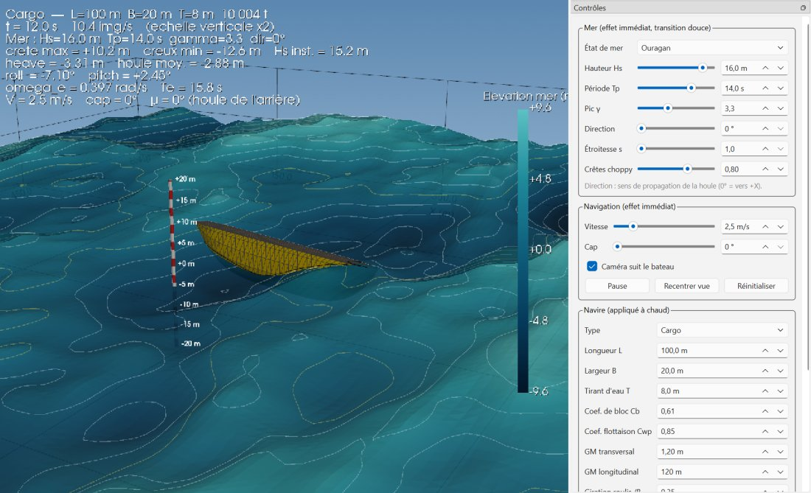
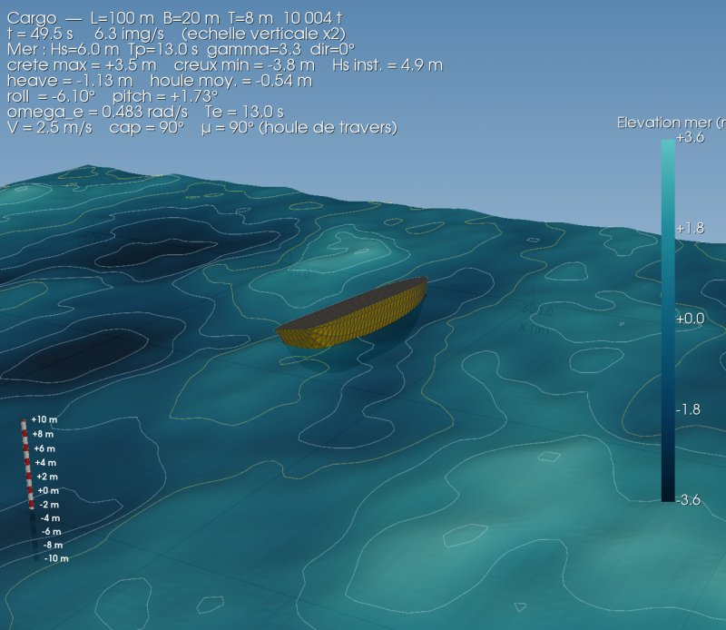
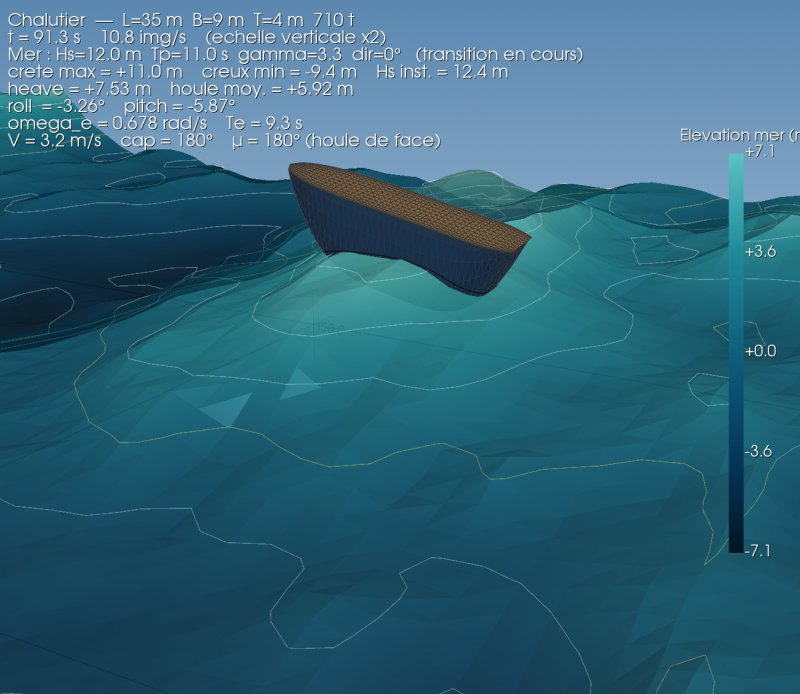

# Jumeau numérique : navire sur mer JONSWAP

Simulation temps réel d'un navire à 6 degrés de liberté (équation de Cummins) sur une mer
irrégulière directionnelle (spectre JONSWAP), avec rendu 3D interactif (PyVista / Qt).
L'état de mer, la navigation et le navire lui-même se modifient en direct, pendant la simulation.



---

## Sommaire

1. [Logique physique](#1-logique-physique)
2. [Réalisation de la simulation](#2-réalisation-de-la-simulation)
3. [Utilisation](#3-utilisation)
4. [Références](#4-références)

---

## 1. Logique physique

Le jumeau numérique couple deux modèles : une **mer** qui produit à chaque instant la surface libre
$\eta(x,y,t)$, et un **navire** dont le mouvement est piloté par la houle vue sous sa flottaison.

### 1.1 Modèle de mer — houle irrégulière JONSWAP ([jonswap.py](jonswap.py))

**Théorie linéaire (Airy).** Une mer réelle est vue comme la superposition d'un grand nombre de
vagues sinusoïdales indépendantes, de fréquences $\omega$ et de directions $\theta$ différentes, à phases
aléatoires $\varphi$ :

$$
\eta(x,y,t) = \sum_{i,j} A_{ij}\cos\!\big(k_{x,ij}\,x + k_{y,ij}\,y - \omega_i t + \varphi_{ij}\big),
\qquad k_x = k\cos\theta,\; k_y = k\sin\theta
$$

**Relation de dispersion (eaux profondes).** Fréquence et nombre d'onde sont liés par
$k = \omega^2 / g$ : les vagues longues vont plus vite que les courtes. (Une version en profondeur finie,
$\omega^2 = g k \tanh(kh)$, existe dans `dispersion_relation` mais n'est pas utilisée.)

**Spectre JONSWAP.** La répartition de l'énergie entre fréquences suit le spectre JONSWAP
(Hasselmann 1973) : un spectre de Pierson-Moskowitz (mer pleinement développée) renforcé autour du pic
par un facteur $\gamma^r$ :

$$
S(\omega) = \alpha\,\frac{g^2}{\omega^5}\exp\!\left[-\frac54\left(\frac{\omega_p}{\omega}\right)^4\right]\gamma^{\,r},
\qquad r = \exp\!\left[-\frac{(\omega-\omega_p)^2}{2\sigma^2\omega_p^2}\right]
$$

avec $\omega_p = 2\pi/T_p$, $\sigma = 0.07$ si $\omega \le \omega_p$, $0.09$ sinon. $\gamma = 3.3$ est la
valeur standard (mer du Nord) ; $\gamma = 1$ redonne Pierson-Moskowitz.

**Étalement directionnel.** L'énergie est répartie autour de la direction moyenne $\theta_m$ par
$D(\theta) \propto \cos^{2s}(\theta - \theta_m)$, normalisée à $\int D\,d\theta = 1$. Plus $s$ est grand,
plus la houle est unidirectionnelle (houle longue) ; $s$ petit donne une mer croisée (mer du vent).

**Amplitudes.** Chaque composante reçoit l'énergie de sa case $(d\omega, d\theta)$ :
$A = \sqrt{2\,S(\omega)\,D(\theta)\,d\omega\,d\theta}$. Les amplitudes sont ensuite **renormalisées**
pour que la hauteur significative simulée soit exactement celle demandée, $H_s = 4\sigma_\eta$
(la formule analytique de $\alpha$ ignore le gain d'énergie du pic JONSWAP, ≈ ×1.5 pour $\gamma = 3.3$).

**Crêtes « choppy » (Tessendorf 2001).** Pour l'affichage uniquement, les points de la surface sont
déplacés horizontalement vers les crêtes, ce qui les rend plus pointues et les creux plus larges,
comme les vraies vagues de tempête. Là où ce déplacement comprime la surface (jacobien $J$ petit),
de l'écume est dessinée. **La physique du navire utilise l'élévation $\eta$ non déformée.**

### 1.2 Modèle de navire — équation de Cummins ([boat.py](boat.py))

**Les 6 degrés de liberté (DDL).**

| DDL | Nom | Translation / rotation |
|-----|-----|------------------------|
| 1 | Cavalement (*surge*) | avance selon x navire |
| 2 | Embardée (*sway*) | dérive latérale |
| 3 | Pilonnement (*heave*) | montée / descente |
| 4 | Roulis (*roll*) | rotation autour de l'axe longitudinal |
| 5 | Tangage (*pitch*) | rotation autour de l'axe transversal |
| 6 | Lacet (*yaw*) | cap |

**Équation du mouvement.** Le navire suit l'équation de Cummins (1962) linéarisée (Ogilvie 1964), où
les coefficients sont évalués à la fréquence de rencontre $\omega_e$ :

$$
\big[M + A(\omega_e)\big]\,\ddot{\boldsymbol\eta} + B(\omega_e)\,\dot{\boldsymbol\eta}
+ C_{cor}\,\dot{\boldsymbol\eta} + C\,\boldsymbol\eta
= F_{exc} + F_{prop}
$$

| Terme | Signification | Modélisation |
|-------|---------------|--------------|
| $M$ | masse et inerties du navire | $m = \rho\,C_b L B T$ ; $I_{xx} = m(k_{xx}B)^2$, $I_{yy} = I_{zz} = m(k_{yy}L)^2$ |
| $A(\omega_e)$ | **masse ajoutée** : eau mise en mouvement avec la coque | fractions de $\rho LBT$ (translations) et de $\rho LB^3/12$, $\rho L^3B/12$ (rotations), ±15 % autour de $\omega_p$ ; couplages sway-roll et heave-pitch |
| $B(\omega_e)$ | **amortissement radiatif** : énergie évacuée par les vagues que le navire crée | $B_{ii} = B_{0,ii}\sqrt{\omega_e/\omega_n}$, avec $B_0$ choisi pour un taux d'amortissement critique $\zeta$ typique (5 à 10 % selon le DDL) |
| $C$ | **raideur hydrostatique** (poussée d'Archimède) | $C_{33} = \rho g A_{wp}$, $C_{44} = \rho g \nabla\,GM_T$, $C_{55} = \rho g \nabla\,GM_L$, couplage $C_{35} = -\rho g A_{wp} x_f$ |
| $C_{cor}$ | Coriolis linéarisé | couplage embardée / lacet proportionnel à la vitesse d'avance |
| $F_{exc}$ | forces de houle | voir ci-dessous |
| $F_{prop}$ | propulsion | poussée $B_{11}\,U_{cible}$ : la vitesse converge vers la consigne |

Les coefficients hydrodynamiques sont une version **simplifiée** des formules de la théorie des tranches
(Salvesen, Tuck & Faltinsen 1970) : ordres de grandeur réalistes, mais pas de calcul de potentiel.

**Fréquence de rencontre.** Un navire qui avance voit passer les vagues à une fréquence différente
de leur fréquence propre (effet Doppler) :

$$
\omega_e = \omega_p - \frac{\omega_p^2}{g}\,V\cos\mu
$$

où $\mu$ est l'angle entre le cap et la direction de propagation de la houle
($0°$ = houle de l'arrière, $90°$ = de travers, $180°$ = de face). $\omega_e$ est bornée à
$[\omega/5,\,2\omega]$ pour éviter la singularité de la houle suiveuse.

**Forces de houle (Froude-Krylov hydrostatique).** À chaque pas, on ajuste par moindres carrés un plan
$\zeta \approx \bar\zeta + s_x x_b + s_y y_b$ sur la surface de mer échantillonnée en 11 × 5 points
sous la flottaison. Ce plan donne la position « idéale » qu'aurait un navire épousant parfaitement la
houle : pilonnement $\bar\zeta$, roulis $\arctan s_y$, tangage $-\arctan s_x$. La raideur tire le navire
vers cette position : $F_{exc} = C\,\boldsymbol\eta_{houle}$. La masse ajoutée et l'amortissement
introduisent le retard de phase et filtrent les vagues courtes ; le moyennage sur toute la flottaison
filtre naturellement les vagues plus courtes que le navire.

**Résonance.** Chaque DDL avec rappel hydrostatique a une période propre
$T_n = 2\pi\sqrt{(M + A)/C}$. Quand la période de rencontre $T_e = 2\pi/\omega_e$ s'en approche,
la réponse est amplifiée (roulis synchrone d'un cargo en houle de travers, par exemple).

### 1.3 Hypothèses et limites

- Théorie linéaire : petites amplitudes de mouvement, pas de déferlement, pas d'interaction vague-vague.
- Eaux profondes uniquement ; pas de diffraction ni de radiation calculées (coefficients empiriques).
- La houle n'excite que pilonnement, roulis et tangage ; cavalement, embardée et lacet ne sont pas
  excités (pas de dérive, pas de force de second ordre).
- Pas de stabilité à grands angles (courbe GZ) : le navire ne peut pas chavirer de façon réaliste.
- Rotation repère navire → repère terrestre appliquée seulement à la position horizontale (petits angles
  pour le reste).
- Domaine de mer périodique de 600 m × 600 m : le navire réapparaît de l'autre côté.

---

## 2. Réalisation de la simulation

### 2.1 Architecture

| Fichier | Rôle |
|---------|------|
| [main.py](main.py) | Point d'entrée : fenêtre Qt, boucle temps réel, liaison panneau ↔ simulation |
| [jonswap.py](jonswap.py) | Mer : spectre, génération de la surface, transitions d'état de mer, couleurs et normales |
| [boat.py](boat.py) | Caractéristiques du navire (`BoatParams`), modèle hydrodynamique (`HydroModel`), maillage de coque (`Boat`) |
| [boat_presets.py](boat_presets.py) | Les 6 navires prédéfinis |
| [simulation.py](simulation.py) | Couplage mer → navire et pas de temps, indépendant de l'affichage |
| [scene.py](scene.py) | Scène 3D PyVista : mer, coque, ligne de flottaison, repères, texte d'infos |
| [ui_panel.py](ui_panel.py) | Panneau de contrôle Qt (émet des signaux, ne connaît pas la physique) |

À chaque image (`Simulation.step`) :

```
1. Transition éventuelle de l'état de mer      SeaState.advance
2. Surface de mer η(x,y,t) + déplacements       SeaState.generate_fields
3. Houle sous la flottaison (ζ̄, s_x, s_y)        HydroModel.waterplane_wave
4. Intégration de Cummins (RK4, n sous-pas)     HydroModel.step_state
5. Mise à jour de l'affichage                   Scene.update
```

### 2.2 Discrétisation

| Grandeur | Valeur | Justification |
|----------|--------|---------------|
| Domaine | 600 m × 600 m | ≥ 2 longueurs d'onde au pic ($\lambda_p \approx 306$ m à $T_p = 14$ s) |
| Maille | 4 m (151 × 151 points) | résout les vagues jusqu'à $4\omega_p$ |
| Fréquences | 30, de $0.5\,\omega_p$ à $4\,\omega_p$ | contient l'essentiel de l'énergie |
| Directions | 17, sur ±90° autour de $\theta_m$ | |
| Coupure | composantes de longueur < 3 mailles mises à zéro | évite le repliement de spectre aux petits $T_p$ |
| Pas de temps | $dt = 0.05$ s | |
| Intégrateur | Runge-Kutta 4 | |

Vérification (`python jonswap.py`) : la hauteur significative mesurée sur la surface simulée
correspond à la consigne.

```
Hs=  1.0 m  Tp= 6.0 s  →  Hs simulé ≈  1.01 m
Hs=  6.0 m  Tp= 8.0 s  →  Hs simulé ≈  6.17 m
Hs= 16.0 m  Tp=14.0 s  →  Hs simulé ≈ 16.05 m
Hs=  3.0 m  Tp= 4.0 s  →  Hs simulé ≈  2.98 m
Continuité au point de référence : +1.485 m → +1.485 m
```

### 2.3 Techniques employées

- **Surface en un produit matriciel.** Évaluer 510 cosinus en 22 801 points à chaque image serait trop
  lent. La somme est réécrite $\eta = \mathrm{Re}\big[E_y\,\mathrm{diag}(c(t))\,E_x^\top\big]$, avec
  $E_x = e^{i k_x x}$ et $E_y = e^{i k_y y}$ précalculés : seul le vecteur $c(t) = A\,e^{i(\varphi - \omega t)}$
  change. Calcul en `complex64` (≈ 2× plus rapide, erreur ~10⁻⁶ m). Élévation et déplacements choppy
  sont obtenus dans le même produit.
- **Mer non périodique.** Les fréquences sont tirées au hasard dans leur bande (*jitter*) : sans cela,
  la mer se répéterait toutes les ~66 s. Phases et jitter sont tirés une fois (graine 42) : la mer
  garde sa « personnalité » quand on change ses paramètres.
- **Transitions douces.** Un changement de paramètre de mer fixe une *cible* ; les paramètres courants
  s'en rapprochent exponentiellement (constante de temps τ = 3 s). Quand $T_p$ ou la direction changent,
  les phases sont corrigées pour que la surface reste **continue sous le navire** (pas de saut brutal).
- **Temps réel.** Le temps simulé suit l'horloge : si une image prend plus de $dt$, la physique fait
  jusqu'à 4 sous-pas pour rattraper ; au-delà, le retard est abandonné plutôt qu'accumulé.
- **Rendu GPU.** Les maillages VTK sont créés une fois puis modifiés en place. Couleur de la mer selon
  l'élévation (échelle fixe liée à $H_s$, sans scintillement), écume aux crêtes, normales calculées pour
  les reflets. La coque change de couleur là où elle est réellement immergée, et la ligne de flottaison
  réelle (intersection coque / mer) est tracée en noir.
- **Exagération verticale ×2** à l'affichage uniquement (une houle de 300 m de long paraît plate à
  l'échelle réelle). Les graduations restent en mètres réels.

---

## 3. Utilisation

### 3.1 Installation et lancement

Prérequis : Python 3.10 ou plus récent (testé avec 3.13), carte graphique compatible OpenGL.

```powershell
python -m venv venv
venv\Scripts\activate            # Linux / macOS : source venv/bin/activate
pip install -r requirements.txt
python main.py
```

Auto-test du modèle de mer, sans interface : `python jonswap.py`.

### 3.2 L'interface

- **Vue 3D (centre).** Souris : clic gauche = rotation, molette = zoom, clic molette ou Maj + clic =
  déplacement.
- **Texte d'infos (haut gauche)** : navire et déplacement ; temps simulé et images/s ; état de mer
  courant (« transition en cours » pendant un changement) ; crête max, creux min et $H_s$ mesuré ;
  pilonnement et houle moyenne sous la flottaison ; roulis et tangage ; $\omega_e$ et $T_e$ ;
  vitesse, cap, angle $\mu$ et incidence (houle de l'arrière / de hanche / de travers / de joue / de face).
- **Mât de marée** rayé rouge et blanc, planté au niveau de mer calme, gradué en mètres.
- **Lignes de niveau** sur la mer ; le niveau 0 (mer calme) est en jaune.
- **Légende** des couleurs de la mer (élévation en m).
- **Panneau « Contrôles » (droite)**, détachable, en trois groupes décrits ci-dessous.

### 3.3 Mer — effet immédiat, transition douce

| Paramètre | Plage | Défaut | Effet |
|-----------|-------|--------|-------|
| Hauteur $H_s$ | 0.5 – 18 m | 16 m | hauteur significative (moyenne du tiers des plus hautes vagues) |
| Période $T_p$ | 4 – 18 s | 14 s | période de pic ; fixe la longueur d'onde $\lambda_p = gT_p^2/2\pi$ |
| Pic $\gamma$ | 1 – 7 | 3.3 | concentration de l'énergie autour du pic (1 = Pierson-Moskowitz) |
| Direction | 0 – 360° | 0° | sens de **propagation** de la houle (0° = vers +X) |
| Étroitesse $s$ | 1 – 10 | 1 | étalement directionnel : grand = houle unidirectionnelle |
| Crêtes choppy | 0 – 1.2 | 0.8 | crêtes pointues à l'affichage (n'affecte pas la physique) |

Préréglages (menu « État de mer ») :

| Préréglage | $H_s$ | $T_p$ |
|------------|-------|-------|
| Calme | 1 m | 6 s |
| Agitée | 6 m | 8 s |
| Tempête | 12 m | 11 s |
| Ouragan | 16 m | 14 s |

### 3.4 Navigation — effet immédiat

| Contrôle | Effet |
|----------|-------|
| Vitesse (0 – 15 m/s) | vitesse de consigne ; le navire y converge progressivement |
| Cap (0 – 360°) | cap imposé (0° = vers +X) ; change l'incidence de la houle |
| Caméra suit le bateau | la caméra accompagne le navire |
| Pause / Reprendre | gèle le temps (les changements de mer s'appliquent alors d'un coup) |
| Recentrer vue | caméra basse centrée sur le navire |
| Réinitialiser | navire replacé au centre, au repos |

### 3.5 Navire — appliqué à chaud

Choisir un **Type**, ajuster éventuellement ses caractéristiques, puis cliquer **Appliquer**
(« Appliquer * » signale des modifications non appliquées). Le nouveau navire remplace l'ancien en
gardant position, cap et vitesse. Un aperçu affiche son déplacement et ses périodes propres, ou les
erreurs de validation (le bouton est alors désactivé). **Rétablir le préréglage** annule les modifications.

| Caractéristique | Signification | Contrainte de validation |
|-----------------|---------------|--------------------------|
| Longueur $L$ | longueur à la flottaison | 5 – 400 m |
| Largeur $B$ | largeur | $0 < B < L$ |
| Tirant d'eau $T$ | enfoncement de la quille | $0 < T < B$ |
| Coef. de bloc $C_b$ | finesse de carène : $\nabla = C_b LBT$ | 0.35 – 0.90 |
| Coef. flottaison $C_{wp}$ | surface de flottaison : $A_{wp} = C_{wp} LB$ | $C_b \le C_{wp} \le 1$ |
| GM transversal | hauteur métacentrique : stabilité en roulis | > 0 |
| GM longitudinal | stabilité en tangage | > 0 |
| Giration roulis / B | rayon de giration $k_{xx}$ (inertie de roulis) | 0.2 – 0.5 |
| Giration tangage / L | rayon de giration $k_{yy}$ (inertie de tangage et lacet) | 0.15 – 0.35 |
| Franc-bord / T | hauteur de coque hors de l'eau, relative au tirant d'eau | > 0 |
| Couleur coque | couleur des œuvres mortes | couleur valide |

Repères : un **GM_T faible** donne un roulis lent et ample (période de roulis longue), un GM_T élevé un
roulis raide et court ; $C_b$ change aussi la forme affichée de la coque (en V pour une coque fine,
fond plat et murailles droites pour un cargo).

**Navires prédéfinis** (périodes propres calculées à $T_p = 14$ s) :

| Type | L × B × T (m) | $C_b$ | GM_T (m) | Vitesse | Déplacement | $T_n$ pilon. / roulis / tangage |
|------|---------------|-------|----------|---------|-------------|----------------------------------|
| Cargo | 100 × 20 × 8 | 0.61 | 1.2 | 2.5 m/s | 10 000 t | 5.5 / 13.2 / 5.1 s |
| Porte-conteneurs | 250 × 32 × 12 | 0.65 | 1.5 | 8 m/s | 64 000 t | 6.9 / 18.7 / 6.1 s |
| Frégate | 125 × 15 × 4.5 | 0.50 | 1.0 | 10 m/s | 4 300 t | 4.1 / 11.2 / 4.3 s |
| Chalutier | 35 × 9 × 4 | 0.55 | 0.8 | 4 m/s | 710 t | 3.8 / 7.5 / 3.9 s |
| Remorqueur | 30 × 10 × 4.5 | 0.60 | 1.5 | 3 m/s | 830 t | 4.1 / 6.0 / 4.0 s |
| Yacht à moteur | 25 × 6 × 1.8 | 0.45 | 1.0 | 6 m/s | 125 t | 2.5 / 4.9 / 3.2 s |

Ajouter un navire : une ligne `BoatParams(...)` dans `PRESETS` ([boat_presets.py](boat_presets.py)) ;
il apparaît automatiquement dans le menu.

### 3.6 Scénarios d'exemple

- **Résonance en roulis** : Cargo, cap 90° (houle de travers), $T_p \approx 13$ s, $H_s$ = 6 m. La période de
  rencontre coïncide avec la période de roulis (13.2 s) : le roulis devient important.
  Passer le cap à 0° ou 180° : le roulis retombe.
- **Effet de la vitesse** : Frégate, houle de face, vitesse 0 puis 15 m/s : $T_e$ raccourcit nettement
  (lisible dans le texte d'infos) et le tangage change.
- **Taille du navire** : même mer « Tempête », Yacht puis Porte-conteneurs : le petit navire épouse
  chaque vague, le grand filtre les vagues plus courtes que lui.

| Résonance en roulis : Cargo, houle de travers, $T_e = 13$ s | Chalutier en tempête, houle de face |
|:---:|:---:|
|  |  |

### 3.7 Réglages avancés (dans le code)

| Constante | Fichier | Rôle |
|-----------|---------|------|
| `DT`, `MAX_SUBSTEPS` | [main.py](main.py) | pas de temps physique, sous-pas max. de rattrapage |
| `Lx`, `Ly`, `dx`, `dy` | [jonswap.py](jonswap.py) | taille du domaine et maille |
| `N_freq`, `N_dir` | [jonswap.py](jonswap.py) | nombre de composantes spectrales (précision ↔ vitesse) |
| `DEFAULTS`, `SEA_PRESETS`, `TAU` | [jonswap.py](jonswap.py) | mer initiale, préréglages, durée des transitions |
| `Z_SCALE`, `SEA_OPACITY`, `HS_MAX` | [scene.py](scene.py) | exagération verticale, transparence de la mer, bornes des axes |
| `SEA_FIELDS`, `BOAT_FIELDS` | [ui_panel.py](ui_panel.py) | plages des curseurs et champs |

---

## 4. Références

- Hasselmann K. et al. (1973). *Measurements of wind-wave growth and swell decay during the Joint North
  Sea Wave Project (JONSWAP)*.
- Cummins W. E. (1962). *The impulse response function and ship motions*.
- Ogilvie T. F. (1964). *Recent progress toward the understanding and prediction of ship motions*.
- Salvesen N., Tuck E. O., Faltinsen O. (1970). *Ship motions and sea loads*.
- Tessendorf J. (2001). *Simulating Ocean Water*.
- Fossen T. I. (2011). *Handbook of Marine Craft Hydrodynamics and Motion Control*.
